<!-- <div style="display: flex; gap: 20px;">
<div style="flex: 1;">

column2

</div>
<div style="flex: 1;">

column2

</div></div> -->


<!-- custom CSS commands -->

<style>

/* gaia variables */
:root {
  --color-background: #fff !important;
  /*--color-foreground: #333 !important;*/
  --color-highlight: #455a64 !important;    /* links */
  /*--color-dimmed: #9e9e9eff !important;*/
  --color-background-stripe: #fff !important;   /* tables */
}
  
section {
  font-size: 2rem;
  padding: 40px;
  padding-top: 20px; /* padding 70px par defaut */
  line-height: 1.15; /* interligne 1.35 par defaut */
}

img[alt~="center"] {
  display: block;
  margin: 0 auto;
}

blockquote {
  background: #ffedcc;
  border-left: 10px solid #d1bf9d;
  margin: 0.5em 10px;
  padding: 0.5em 10px;
}
blockquote:before{
  content: unset;
}
blockquote:after{
  content: unset;
}
/* @theme fa */
@import url("https://cdnjs.cloudflare.com/ajax/libs/font-awesome/6.5.0/css/all.min.css");

/* .right_and_small p { 
  background: #ffedcc; 
text-align: right !important;
margin-left: 0;  
font-size: 1rem; 
} */

table {
  width: 100%;
}


/* Titres */
/* h1 { background: #ffedcc; padding: 0em; margin: 0.2em 0 -0em; line-height: 1.10; border: 1px solid gray;}
h2 { margin: 0.25em 0 -0em; line-height: 1.12; border: 1px solid gray; }
h3 { margin: 0.3em 0 -0em;  line-height: 1.15; border: 1px solid gray; } */

p { margin-top: 0.5em; }
pre { margin: 0.5em 0; }

ul,
ol  { margin: 0.5em 0; padding-left: 1.1em; }
li  { margin: 2em 100; }

</style>


# **Git: a Hands-on Tutorial**

**Git/GitLab Workshop** <i class="fa-solid fa-screwdriver-wrench"></i>

<br />

<i class="fa-solid fa-file"></i> [pdf version of this slide deck](index.pdf)

<i class="fa-solid fa-globe"></i> [latest online version](https://git.gitlabpages.uliege.be/hands-on-tutorial/)

---

<!-- footer: ' <i class="fa-brands fa-square-git"></i> a Hands-on Tutorial &mdash; [<i class="fa-solid fa-envelope"></i>](mailto:r.boman@uliege.be) R.Boman &mdash; <i class="fa-solid fa-calendar"></i> sep 2025 &mdash; 
[<i class="fa-solid fa-house"></i>](#table-of-contents)'
-->

<!-- _backgroundImage: url('https://marp.app/assets/hero-background.svg') -->

# Table of Contents

<div style="display: flex; gap: 20px;">
<div style="flex: 2;">

<br/>

1. [Install git](#1-install-git)
2. [Configure GitLab](#2-configure-gitlab)
3. [Learn Git/GitLab](#3-learn-gitgitlab)
4. [Additional tools](#4-additional-tools)
5. [Conclusions](#5-conclusions)

</div>
<div style="flex: 1;">

<style scoped>
p {
  font-size: 20px;
}
</style>

### <i class="fa-solid fa-circle-question"></i> Who am I?


[<i class="fa-solid fa-user"></i>](https://www.uliege.be/cms/c_9054334/fr/repertoire?uid=u180139) [<i class="fab fa-linkedin"></i>](https://www.linkedin.com/in/rboman/) [<i class="fa-brands fa-square-gitlab"></i>](https://gitlab.uliege.be/rboman) [<i class="fa-brands fa-square-github"></i>](https://github.com/rboman/) [<i class="fa-brands fa-orcid"></i>](https://orcid.org/0000-0002-4883-0383) [<i class="fa-brands fa-researchgate"></i>](https://www.researchgate.net/profile/Romain-Boman) [<i class="fa-brands fa-google-scholar"></i>](https://scholar.google.be/citations?user=P6zCaCkAAAAJ)
[Dept. of Aerospace & Mech. Eng.]([Accueil](https://www.am.uliege.be/cms/c_3482638/fr/a-m))
*Nonlinear Computational Mechanics*
Lead developer of [Metafor](http://metafor.ltas.ulg.ac.be/)


</div></div> 


---
<!-- _backgroundImage: url('https://marp.app/assets/hero-background.svg') -->
<!-- _class: lead -->


# 1. Install git

<br />

- <i class="fa-brands fa-apple"></i> [macOS](#toc_install_git_macos)
- <i class="fa-brands fa-linux"></i> [Linux](#toc_install_git_linux)  
- <i class="fa-brands fa-windows"></i> [Windows](toc_install_git_windows)
- <i class="fa-solid fa-screwdriver-wrench"></i> [Configure git](#toc_configure_git)

---

<!-- footer: ' <i class="fa-brands fa-square-git"></i> a Hands-on Tutorial &mdash; [<i class="fa-solid fa-envelope"></i>](mailto:r.boman@uliege.be) R.Boman &mdash; <i class="fa-solid fa-calendar"></i> sep 2025 &mdash; 
[<i class="fa-solid fa-house"></i>](#table-of-contents)
- [install git](#1-install-git)' 
-->

# <i class="fa-solid fa-circle-question"></i> What is Git, what is GitLab?

## Git

- Git is a **version control system** used by developers to collaborate and track successive changes in their code. 

- Git is a **command-line program** on your computer (`git.exe` on Windows).

- You can use Git locally on your computer to manage different versions of your files in a given folder.

- The git website is https://git-scm.com/


> This first section of the presentation explains how to install the git executable on your own computer.

---

# <i class="fa-solid fa-circle-question"></i> What is Git, what is GitLab?

## GitLab

- In order to **collaborate** with other developers, the versions of your files and the related git data should be shared on the web.

- This is done by a **web application** such as [GitLab](https://about.gitlab.com/), [GitHub](https://github.com/), [Bitbucket](https://bitbucket.org/), etc.

- Unlike GitHub which is owned by Microsoft, GitLab is *free and open-source software*. Anyone can run a GitLab server (a *GitLab instance*). The **ULiège has its own GitLab instance**: [gitlab.uliege.be](https://gitlab.uliege.be/)  ($\neq$ [gitlab.com](https://gitlab.com/)!).

- GitLab provides you with **many other tools** beyond git: wikis, user management, continuous integration (CI), web hosting ("pages"), etc.

> This presentation also explains how to access and how to use the GitLab instance of the University of Liège.

---

# <i class="fa-brands fa-apple"></i> Install git on macOS 
<span id="toc_install_git_macos"></span>

## Install the git executable

<br/>

<i class="fa-regular fa-square-caret-right"></i> Open a terminal and type `git`. 

If git is not installed yet, the system will ask you whether you want to install the "developer tools". 
```
xcode-select: note: no developer tools were found at '/Applications/Xcode.app',
requesting install. Choose an option in the dialog to download the command line 
developer tools.
```

<br/>
<i class="fa-regular fa-square-caret-right"></i> Agree and proceed with the installation...

---

# <i class="fa-brands fa-apple"></i> Install git on macOS

## Set the default text editor

You can change the default **text editor** used by git by setting the `EDITOR` environment variable. 

<i class="fa-regular fa-square-caret-right"></i> Edit your `~/.zshrc` with
```
open -t ~/.zshrc
```

<i class="fa-regular fa-square-caret-right"></i> Then, add a line similar to the following line at the end of the file:
```
EDITOR=nano
```
[GNU nano](https://nano-editor.org/) is a good choice because it is a terminal editor with no graphical user interface and it is easy to use.

<i class="fa-regular fa-square-caret-right"></i> Save the file after modification. 

---

# <i class="fa-brands fa-apple"></i> Install git on macOS

## Possible problem

If saving the file fails, it could be due to the fact that `~/.zshrc` is owned by `root`. 

You can acquire the ownership of the file with the following command:
```
sudo chown $(whoami):$(id -gn) ~/.zshrc
```
and type your password since administrator privileges are required.

---

# <i class="fa-brands fa-linux"></i> Install git on Linux
<span id="toc_install_git_linux"></span>


## CECI clusters

On the [CECI clusters](http://www.ceci-hpc.be/), git is already available.

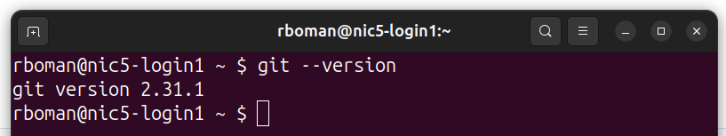

## Your own Linux PC

On your own PC running Linux, you can install git with the package manager. For example, with Ubuntu:

```
sudo apt install git
```

---

# <i class="fa-brands fa-linux"></i> Install git on Linux 

## Configure the default text editor

Git will try to open a **text editor** when running certain commands. 

The default editor is [vim](https://www.vim.org/) which is rather difficult to use. 

If you don't plan to use vim, set the environment variable `EDITOR` to the name of your preferred editor by adding the following line at the end of your `~/.bashrc` file:

```
sudo apt install nano
echo 'export EDITOR=nano' >> ~/.bashrc
```

It could be `nano`, `emacs`, or any other user-friendly text editor available on Linux. 

---

# <i class="fa-brands fa-windows"></i> Install git on Windows 
<span id="toc_install_git_windows"></span>

If you work on Windows, git is not provided by Microsoft with the OS. You must install it before the next steps.

<i class="fa-regular fa-square-caret-right"></i>  Download the latest version of git from the website: https://git-scm.com/

<i class="fa-regular fa-square-caret-right"></i>  Double-click on the installer, then follow the instructions. 

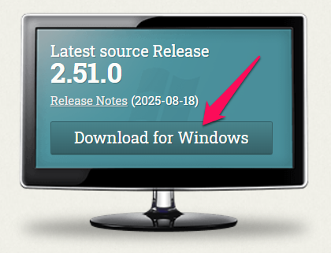

---

# <i class="fa-brands fa-windows"></i> Install git on Windows

<i class="fa-regular fa-square-caret-right"></i> Choose the default options except for the **default editor** which is configured for "vim" (an old type of editor which is rather difficult to use).

<br/>

<div style="display: flex; gap: 20px;">
<div style="flex: 1;">

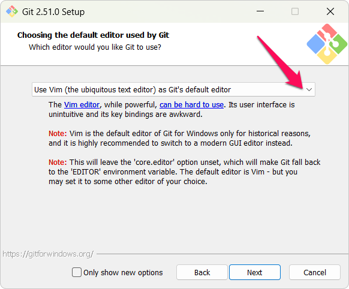

</div>
<div style="flex: 1;">

<i class="fa-regular fa-square-caret-right"></i> Choose one editor that you know well instead of vim (e.g. Notepad or [Notepad++](https://notepad-plus-plus.org/) on Windows).

<br/>

Once installed, git is available from any command-line window 

<i class="fa-regular fa-square-caret-right"></i> Run "Command Prompt", then type `git` in the terminal.

</div>
</div>

---

# <i class="fa-solid fa-screwdriver-wrench"></i> Configure git (<i class="fa-brands fa-apple"></i> <i class="fa-brands fa-linux"></i>  <i class="fa-brands fa-windows"></i>)
<span id="toc_configure_git"></span>

<i class="fa-regular fa-square-caret-right"></i> Execute these 3 commands in a terminal:

```
git config --global user.name "Your Name"
git config --global user.email "your_email@student.uliege.be"
git config --global init.defaultBranch main
```

Why?
- Git must know your name and e-mail address because all your personal git operations will be identified with these 2 strings.
- We choose the new name `main` for the default branch instead of `master`.

Notes:
- This configuration step should be done **once per computer**, the first time you use git.
- These data are stored in `~/.gitconfig` and can be modified anytime by hand.

---

<!-- footer: ' <i class="fa-brands fa-square-git"></i> a Hands-on Tutorial &mdash; [<i class="fa-solid fa-envelope"></i>](mailto:r.boman@uliege.be) R.Boman &mdash; <i class="fa-solid fa-calendar"></i> sep 2025 &mdash; 
[<i class="fa-solid fa-house"></i>](#table-of-contents)' 
-->
<!-- _backgroundImage: url('https://marp.app/assets/hero-background.svg') -->
<!-- _class: lead -->


# 2. Configure GitLab

<br/>

- <i class="fa-solid fa-id-card"></i> [Register to gitlab.uliege](#toc_register_gitlab)
- <i class="fa-solid fa-key"></i> [Configure SSH keys](#toc_ssh_keys)

---

<!-- footer: ' <i class="fa-brands fa-square-git"></i> a Hands-on Tutorial &mdash; [<i class="fa-solid fa-envelope"></i>](mailto:r.boman@uliege.be) R.Boman &mdash; <i class="fa-solid fa-calendar"></i> sep 2025 &mdash; 
[<i class="fa-solid fa-house"></i>](#table-of-contents)
- [configure GitLab](#2-configure-gitlab)' 
-->

## <i class="fa-solid fa-id-card"></i> Register to the GitLab instance of ULiège
<span id="toc_register_gitlab"></span>

<i class="fa-regular fa-square-caret-right"></i> Go to https://gitlab.uliege.be/, then click on **ULiège Login**

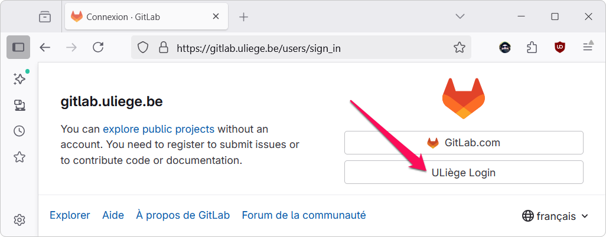

You will be redirected to the ULiège authentication screen. 

<i class="fa-regular fa-square-caret-right"></i> Enter your ULiege ID (`sXXXXXXX` or `uXXXXXX`) and password.

---

# <i class="fa-solid fa-key"></i> Configure SSH keys
<span id="toc_ssh_keys"></span>

The GitLab of ULiège does not allow you to use your student-ID / password for git commands. 

It uses a **pair of "SSH keys"** (one "private key" that should never be shared with anyone and a "public key" which can be given to anyone who wants to check that you own the "private key").

<div style="display: flex; gap: 20px;">
<div style="flex: 1;">

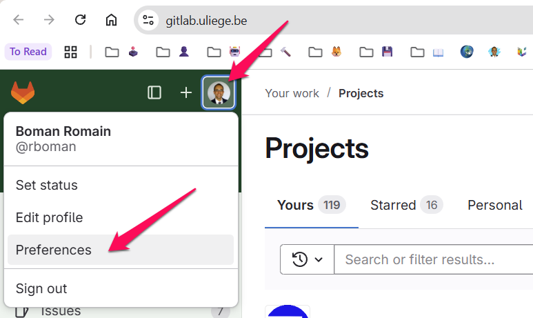

</div>
<div style="flex: 1;">

<i class="fa-regular fa-square-caret-right"></i> On GitLab, go to the [User Settings](https://gitlab.uliege.be/-/user_settings/profile), then choose "SSH keys" on the menu on the left.

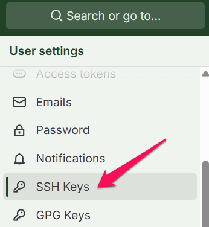

</div></div> 

---

# <i class="fa-solid fa-key"></i> Configure SSH keys

Follow the following procedure to create a SSH-key pair: 

<i class="fa-regular fa-square-caret-right"></i> Use the "RSA" type, which is more compatible with older machines.

```
$ ssh-keygen -o -t rsa -b 4096 -C "demo"
```
"`demo`" is a random name used for this tutorial. It can be anything.

<br/>

Output:
```
Generating public/private rsa key pair.
Enter file in which to save the key (/c/Users/boman/.ssh/id_rsa):
Enter passphrase (empty for no passphrase):
Enter same passphrase again:
Your identification has been saved in /c/Users/boman/.ssh/id_rsa.
Your public key has been saved in /c/Users/boman/.ssh/id_rsa.pub.
The key fingerprint is:
SHA256:8ijxJLH1SETJZVkbRbBUXXdlmXE17C3mspK/KrSC/Jc demo
```

---

# <i class="fa-solid fa-key"></i> Configure SSH keys

⚠️ You can use an **empty passphrase** if you do not share your private key (if it stays on your laptop, or if you trust the system administrator). 

This is convenient because you won't need to type a password each time. But be sure that nobody has access to your files on your computer if you choose to do so.

⚠️ **Do not change the path** where the keys are written to. Otherwise you will have to specify them as an argument of each git command you type! 

The `ssh-keygen` command created 2 files located in `~/.ssh/` (<i class="fa-brands fa-apple"></i> <i class="fa-brands fa-linux"></i>) or `c:\Users\your_name\.ssh\` (<i class="fa-brands fa-windows"></i>): 
- a **public key** `id_rsa.pub`
- a **private key** `id_rsa`. The private key is similar to a password. Anyone who owns this file is able to behave as you on GitLab! It should never be shared if it is not protected by a password!

---

# <i class="fa-solid fa-key"></i> Configure SSH keys

<i class="fa-regular fa-square-caret-right"></i> Click on the "**Add new key**" button and copy/paste the content of `id_rsa.pub` in the box on GitLab:

<div style="display: flex; gap: 20px;">
<div style="flex: 1;">

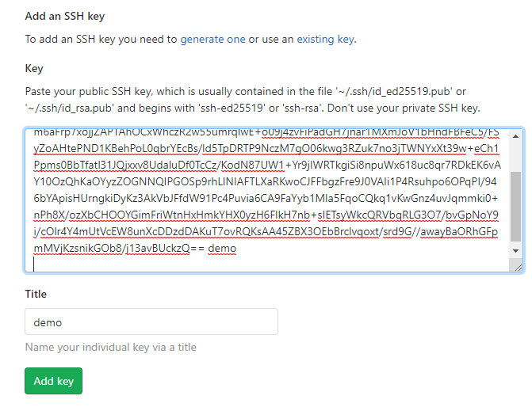

</div>
<div style="flex: 1;">

<br />

<i class="fa-regular fa-square-caret-right"></i> On Windows or macOS, open the public-key file (file `.ssh/id_rsa.pub`) in an editor...

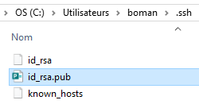

...and copy/paste its content into the box of the GitLab website.

</div></div>

---

# <i class="fa-solid fa-key"></i> Configure SSH keys

<div style="display: flex; gap: 20px;">
<div style="flex: 1;">


</div>
<div style="flex: 1;">

On Linux, this can be done by displaying the public key in the terminal:

```
cat ~/.ssh/id_rsa.pub
```

then selecting it with the mouse and using the middle mouse button to paste it in the GitLab box.

<br/><br/>

<i class="fa-regular fa-square-caret-right"></i> Then click on the "**Add key**" button on the GitLab page.

</div></div>

---

# <i class="fa-solid fa-key"></i> Configure SSH keys

## Test the connection to gitlab.uliege.be

You can test that you are able to connect to GitLab with the following command in a terminal: 

```
ssh -T git@gitlab.uliege.be
```

(check that you target `gitlab.uliege.be` instead of `gitlab.com` if you follow the instructions from the GitLab website!)

It should produce the following output:

```
The authenticity of host 'gitlab.uliege.be (139.165.47.38)' can't be established.
ECDSA key fingerprint is SHA256:4DyJeec4s+THW2EOZw5xjGgk6ZUcgmWjCcX33hVep7g.
Are you sure you want to continue connecting (yes/no)? yes
```

answer `yes` (you will be asked only once per machine).

---

# <i class="fa-solid fa-key"></i> Configure SSH keys

## Test the connection to gitlab.uliege.be

This is the expected output:
```
Warning: Permanently added 'gitlab.uliege.be,139.165.47.38' (ECDSA) to the list of known hosts.

Welcome to GitLab, @Your_name!
```

If you do not get the welcome message "*Welcome to GitLab*", something went wrong in the previous steps. Read again the instructions.

<br/>

> If you encounter any problem with these commands, the latest official procedure from the GitLab documentation can be found [here](https://gitlab.uliege.be/help/user/ssh.md#generate-an-ssh-key-pair).

---

# <i class="fa-solid fa-cloud-arrow-down"></i> Clone a repository

As an additional test your can try to retrieve the source code from this presentation with the following command:

```
git clone git@gitlab.uliege.be:git/hands-on-tutorial.git
```

---

<!-- footer: ' <i class="fa-brands fa-square-git"></i> a Hands-on Tutorial &mdash; [<i class="fa-solid fa-envelope"></i>](mailto:r.boman@uliege.be) R.Boman &mdash; <i class="fa-solid fa-calendar"></i> sep 2025 &mdash; 
[<i class="fa-solid fa-house"></i>](#table-of-contents)' 
-->
<!-- _backgroundImage: url('https://marp.app/assets/hero-background.svg') -->
<!-- _class: lead -->


# 3. Learn Git/GitLab

- <i class="fa-solid fa-circle-question"></i> [Introduction](#toc_learn_into)
- <i class="fa-solid fa-folder-plus"></i> [Create a new project](#toc_create_new_project)
- <i class="fa-solid fa-clone"></i> [Clone the project](#toc_git_clone)
- <i class="fa-solid fa-magnifying-glass"></i> [git status](#toc_git_status)
- <i class="fa-solid fa-code-commit"></i> [git commit / git push](#toc_git_commit_push)
- <i class="fa-solid fa-rotate-left"></i> [Undo mistakes](#toc_undo_mistakes)
- <i class="fa-solid fa-users"></i> [Collaborate with others](#toc_collaborate)
- <i class="fa-solid fa-code-branch"></i> [Branches](#toc_branches)
- <i class="fa-solid fa-code-pull-request"></i> [Merge branches](#toc_merge_branches)
- <i class="fa-solid fa-tag"></i> [git tag](#toc_git_tag)
- <i class="fa-solid fa-lightbulb"></i> [Interesting commands](#toc_interesting_cmds)

---

<!-- footer: ' <i class="fa-brands fa-square-git"></i> a Hands-on Tutorial &mdash; [<i class="fa-solid fa-envelope"></i>](mailto:r.boman@uliege.be) R.Boman &mdash; <i class="fa-solid fa-calendar"></i> sep 2025 &mdash; 
[<i class="fa-solid fa-house"></i>](#table-of-contents)
- [learn git/gitlab](#3-learn-gitgitlab)' 
-->

# <i class="fa-solid fa-circle-question"></i> What is git again?
<span id="toc_learn_into"></span>

- Git is a **version control system**.

- It allows you to:
  -  keep track of changes in **text files** (who wrote this line of code? when? why?...),
  -  **collaborate** with others (merge works),
  -  avoid losing your work (**back-up**),
  -  help you **find bugs** in source code (differences with previous working versions),


<br />
<br />

image: [PHD Comics: notFinal.doc](https://phdcomics.com/comics.php?f=1531)


---

# <i class="fa-solid fa-folder-plus"></i> Create a new project on GitLab
<span id="toc_create_new_project"></span>

Although it is possible to create a project locally and to send it later to GitLab, we choose to create a project on GitLab and to download it (**clone** it) onto our PC. 

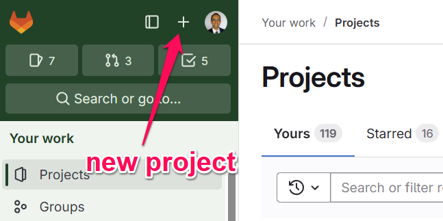

<br/>

<i class="fa-regular fa-square-caret-right"></i> Create a **blank project** and name it as you like.


---

# <i class="fa-solid fa-clone"></i> Clone the project to your PC
<span id="toc_git_clone"></span>

<i class="fa-regular fa-square-caret-right"></i> Get the URL of your project with the **Code** button.

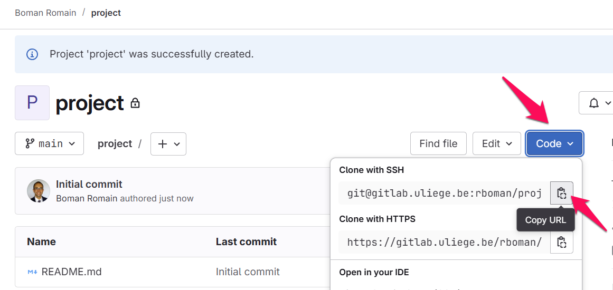

---

# <i class="fa-solid fa-clone"></i> Clone the project to your PC

<i class="fa-regular fa-square-caret-right"></i> In a terminal, type `git clone` then paste the URL:

```
git clone git@gitlab.uliege.be:rboman/project.git
```
<i class="fa-regular fa-square-caret-right"></i> Then go in the folder
```
cd project
```

**Vocabulary**:
> A git project is also called a **repository**. It is a database containing all the successive versions of your files.
> 
> Your project on GitLab is a **remote repository** (or simply **a remote**) compared to a **local repository** on your computer.
> 
> A **version** is also called a **revision** or a **commit** (from the name of the git command which creates a new version)

---

# <i class="fa-solid fa-magnifying-glass"></i> Inspect the folder
<span id="toc_git_status"></span>

<i class="fa-regular fa-square-caret-right"></i> Open the project folder and show **hidden** files/folders:

<div style="display: flex; gap: 20px;">
<div style="flex: 1;">

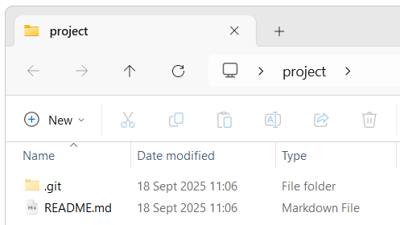

</div>
<div style="flex: 1;">

<br/>

> The contents of the folder in its current state are called the **working tree** (or **working copy**). 
>
> For now, it corresponds to the initial version of the project.

</div></div>

- The folder contains a `.git/` folder which **should never be deleted**. It contains a copy of the repository from GitLab and other internal data useful to git. 
- The file `README.md` is created by default by GitLab in a "blank project". It is displayed in the main page of your repository (see <i class="fab fa-markdown"></i>  [markdown syntax](https://www.markdownguide.org/getting-started/)).

---

# <i class="fa-solid fa-folder-tree"></i> Check the status of your working tree

<i class="fa-regular fa-square-caret-right"></i> **Anytime you are lost** you can ask git for help with the command:

```
git status
```
It gives you insights about the current state of the working tree:
```
On branch main
Your branch is up to date with 'origin/main'.

nothing to commit, working tree clean
```
It is very important to understand the output of this command.
<br/>

> 💡Run this command regularly for useful hints from git.

---

# <i class="fa-solid fa-clipboard-question"></i> Understand the output of "git status"

```
on branch main
```
- Versions are chained from the first one to the next ones in a **tree structure**.
- The simplest tree is just a single **branch** (named `main`):

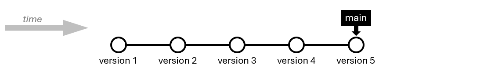 

- But it can become more complicated with several branches (see later):
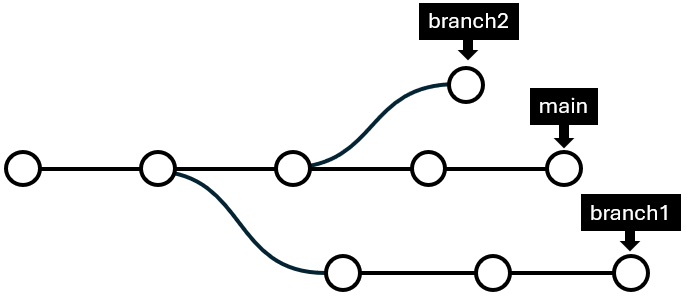 

---

# <i class="fa-solid fa-clipboard-question"></i> Understand the output of "git status"

```
Your branch is up to date with 'origin/main'
```
- `origin` is a synonym for "GitLab". This is the source of the clone operation.
- ⚠️ There are already **3 branches** called `main`:
    1. The `main` branch of the local copy of the repository on your computer:
         -  we simply call it `main` (or "local `main`").
    2. The actual `main` branch on the GitLab server (it could evolve independently of the one of your local repository):
        - we call it "`main` on `origin`".
    3. The `main` branch on GitLab "*as it was seen the last time GitLab was accessed over the network*":
        - it is called `origin/main`.

---

# <i class="fa-solid fa-clipboard-question"></i> Understand the output of "git status"

```
Your branch is up to date with 'origin/main'
```
Thus, the message says that the local `main` branch and the `main` branch of the repository on GitLab (as it was seen the last time we accessed GitLab) are in the same state.

⚠️ Nothing is said about the real current state of the `main` branch on GitLab.

Summary:
|  name              |  description          |
| ----               | ----                  |
| `main`             | your local branch     |
| `main` on `origin` | the branch on GitLab  |
| `origin/main`      | the branch on GitLab (stored in a cache)   |   

---

# <i class="fa-solid fa-clipboard-question"></i> Understand the output of "git status"

```
nothing to commit, working tree clean
```

<br/>

Vocabulary:

> In Git, **To commit** means to create a new version (a new circle on the tree structure of the repository.
>
> By extension, **a commit** refers to a version / a "circle" of the tree. The correct word is **a revision**.

<br/>

The message thus says that everything is in a clean state. There are no modifications compared to the reference version of the repository.

---

# <i class="fa-solid fa-code-commit"></i> Create a new version (a new commit)
<span id="toc_git_commit_push"></span>

<i class="fa-regular fa-square-caret-right"></i> Modify the working copy of `README.md` with your text editor.

```
git status
```

```
On branch main
Your branch is up to date with 'origin/main'.

Changes not staged for commit:
  (use "git add <file>..." to update what will be committed)
  (use "git restore <file>..." to discard changes in working directory)
        modified:   README.md

no changes added to commit (use "git add" and/or "git commit -a")
```

The file is "modified".

You can use `git diff` to display the differences between your working copy and the reference version.

---

# <i class="fa-solid fa-code-commit"></i> Create a new version (a new commit)

Creating a new version is a 2-step procedure.

## Step 1: staging changes

<i class="fa-regular fa-square-caret-right"></i> The new version is created by "**adding**" modifications with `git add`.

```
git add README.md
```

This command copies the modified file in the **staging area** (also called **the index** or **the cache**).

The staging area is a place where commits are incrementally prepared before being commited to the repository.

You can imagine this place as being the hidden `.git/` folder in your local folder, which already holds your local repository.

---
# <i class="fa-solid fa-code-commit"></i> Create a new version (a new commit)

## Step 2: commit changes

<i class="fa-regular fa-square-caret-right"></i> Once all modifications have been added to the staging area, we can create a new version with:
```
git commit
```
Git asks for a message describing the changes. 

<i class="fa-regular fa-square-caret-right"></i> Write **something relevant**, save and quit the editor.

```
[main e4ebafc] remove default text added by gitlab
 1 file changed, 1 insertion(+), 91 deletions(-)
```
The message says that a new version numbered `e4ebafc` has been created. This identification string is the beginning of a **unique long hash number** referring to this particular set of modifications, done by you at this particular moment.

---

# <i class="fa-solid fa-list-ul"></i> Display a list commits

```
git log
```

```
commit e4ebafc80f1b9f7946c3d6a00a675a97de7978cc (HEAD -> main)
Author: Romain Boman <[<i class="fa-solid fa-envelope"></i>](mailto:r.boman@uliege.be) R.Boman@uliege.be>
Date:   Thu Sep 18 15:37:00 2025 +0200

    remove default text added by gitlab

commit e59d0251f3fda3175b41072ad7a9bb71e3078d78 (origin/main, origin/HEAD)
Author: Boman Romain <[<i class="fa-solid fa-envelope"></i>](mailto:r.boman@uliege.be) R.Boman@uliege.be>
Date:   Thu Sep 18 08:47:42 2025 +0000

    Initial commit
```
The tree structure of the repository looks like this:
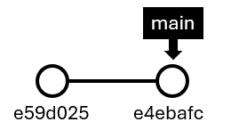

---

# <i class="fa-solid fa-cloud-arrow-up"></i> Send changes to GitLab

```
git status
```
```
Your branch is ahead of 'origin/main' by 1 commit.
  (use "git push" to publish your local commits)
```

<br/>

<i class="fa-regular fa-square-caret-right"></i> Our new commit can be sent to GitLab with:

```
git push
```

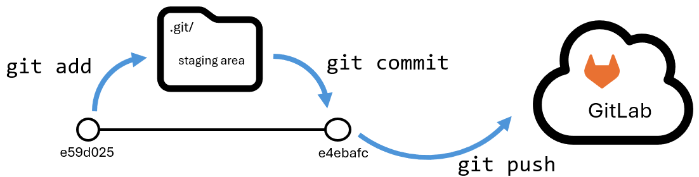

---
# <i class="fa-solid fa-cloud-arrow-up"></i> Send changes to GitLab

The "tree of commits" (the **Repository graph**) can be displayed on GitLab:

<br/>

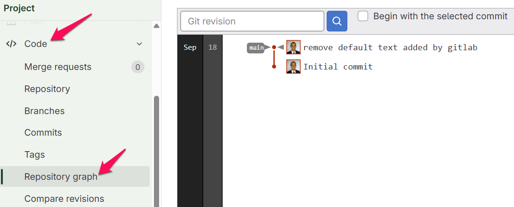


---

# <i class="fa-solid fa-square-plus"></i> Add a new file

<i class="fa-regular fa-square-caret-right"></i> Create `main.c`:

```c
#include <stdio.h>
int main() {
  printf("Hello world!\n");
  return 0;
}
```
<i class="fa-regular fa-square-caret-right"></i> Execute `git status`:

```
Untracked files:
  (use "git add <file>..." to include in what will be committed)
        main.c

nothing added to commit but untracked files present (use "git add" to track)
```
<i class="fa-regular fa-square-caret-right"></i> Add `main.c` to the staging area:
```
git add main.c
```

---
# <i class="fa-solid fa-square-plus"></i> Add a new file

<i class="fa-regular fa-square-caret-right"></i> Then commit the changes:
```
git commit -m "add main source file"
```
option `-m` allows you to specify the message without opening the editor.

<br/>

<i class="fa-regular fa-square-caret-right"></i> Push the changes to GitLab
```
git push
```

<br/>

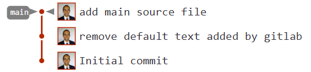

---
# <i class="fa-solid fa-rotate-left"></i> Undo mistakes
<span id="toc_undo_mistakes"></span>

<i class="fa-solid fa-circle-exclamation"></i> **Important note**:

- Git handles **text files** very efficiently. Internally, git stores the differences between versions so that it is very effective. 
- Sometimes it is useful to add **binary files** to a repository (e.g. images for a web site that will not change frequently). 
In this case, **each version** is stored forever in the repository and the size could increase a lot.

> ⚠️Be aware that git stores the whole history of your files. 
> 
> If a file is created, then deleted, it is still in the repository!
> 
> The **biggest mistake** you can do with git is to add a big binary file to your repository and continue your work as usual. 

---
# <i class="fa-solid fa-rotate-left"></i> Undo mistakes

Most of the "undo" commands are given by `git status` (there is almost nothing to remember).

## Undo local modifications

<i class="fa-regular fa-square-caret-right"></i> Change the contents of `main.c`; then execute `git status`:
```
Changes not staged for commit:
  (use "git add <file>..." to update what will be committed)
  (use "git restore <file>..." to discard changes in working directory)
        modified:   main.c
```
Thus `git restore main.c` is what you are looking for.

<br/>

<i class="fa-regular fa-square-caret-right"></i> Run `git diff` before restoring the file in order to see the differences in your terminal.

---
# <i class="fa-solid fa-rotate-left"></i> Undo mistakes

## Rename a file

<i class="fa-regular fa-square-caret-right"></i> Rename `main.c` into `hello.c`
```
git mv main.c hello.c
```
`mv` stands for "move". 

It is equivalent to:

```
move main.c hello.c  # rename the file using the OS (use "mv" if linux/mac)
git add hello.c      # add the new file to the cache
git add main.c       # add the deletion to the cache!
```
Note the "git **add**" (not "remove"!) to transfer the deletion to the staging area!

> <i class="fa-solid fa-screwdriver-wrench"></i> Practise this and run "git status" between each command.


---
# <i class="fa-solid fa-rotate-left"></i> Undo mistakes

## Undo the renaming (in the index)

No commit has been performed yet.

> <i class="fa-solid fa-screwdriver-wrench"></i> Next, try to undo the command with the help of "git status".

<br />

Solution:
```
git restore --staged main.c
git restore --staged hello.c
git restore main.c
del hello.c
```


---
# <i class="fa-solid fa-rotate-left"></i> Undo mistakes

## Delete a file

<i class="fa-regular fa-square-caret-right"></i> Delete `README.md`:

```
git rm README.d
```
is equivalent to:
```
del README.md         # use 'rm' if linux/mac
git add README.md
```
Once again and counterintuitively, the last command uses `git add`.

<i class="fa-regular fa-square-caret-right"></i> This time, commit the change so that a new revision without `README.md` is created:

```
git commit -m "remove README.md"
```

---
# <i class="fa-solid fa-rotate-left"></i> Undo mistakes

## Recover a file that was removed and commited 

Many possibilities depending on the severity of the problem...

<i class="fa-regular fa-square-caret-right"></i> **Case 1: the commit has been pushed to GitLab**

<i class="fa-regular fa-square-caret-right"></i> We can just "revert" the commit:

```
git revert HEAD
```
In Git `HEAD` always refers to the current commit you are working on. 

The command plays a particular commit backwards (changes are applied "in reverse")

> In this scenario, a new commit is created. 
> The mistake will be present forever in the repository.


---
# <i class="fa-solid fa-rotate-left"></i> Undo mistakes

## Recover a file that was removed and commited

<i class="fa-regular fa-square-caret-right"></i> **Case 2: the commit has not been pushed to GitLab**

<i class="fa-regular fa-square-caret-right"></i> We can "rewind" `master`:

```
git checkout --hard HEAD~
```

<br />

In this command `HEAD~` (or `HEAD^`) refers to the previous commit.
Use `HEAD^^`, `HEAD^^^` to rewind earlier or `git log` to specify the commit hash. 

<br />

> ⚠️ If the commit was pushed, you may not rewind your branch, because somebody is possibly working on it too!

---
# <i class="fa-solid fa-rotate-left"></i> Undo mistakes

## Recover from the biggest mistake

The biggest mistake you can do is to add, commit and push a very big binary file to your repository. It is a very common mistake from beginners.

```
git add .       # <= adds everything from the current folder
```

```
C:\Users\r_bom\Desktop\project>git commit -m "add everything"
[main e936e39] add everything
 1 file changed, 0 insertions(+), 0 deletions(-)
 create mode 100644 video.mp4
```
😥 We added `video.mp4` by mistake!

```
git push       # we push without reading the message...
```

takes a long time... 

---
# <i class="fa-solid fa-rotate-left"></i> Undo mistakes

## Recover from the biggest mistake

- This mistake will permanently make the repository very large. 
- All the future "clone" command will download the video from GitLab, even if we remove it with `git revert`...

In this case, you should contact your co-workers if it is possible, undo the commit and push the state of your branch with

```
git reset --hard HEAD^
git push --force
```

<br />

In any other cases, never use this command (this should be enabled in Settings / Repository / Protected branches). Ask for help.

---
# <i class="fa-solid fa-eye-slash"></i> Ignore files

The easiest way to avoid this mistake is to ask git **to ignore some file patterns**:

<i class="fa-regular fa-square-caret-right"></i> Create a file named `.gitignore` with this content:
```
*.mp4
a.exe
output/
```
- The first line ignores videos with the `mp4` extension.
- The second one ignores the executable `a.exe` created by `gcc main.c`.
- The third line ignores all the files in folders named `output`

<i class="fa-regular fa-square-caret-right"></i> Then
```
git add .gitignore
git commit -m "add .gitignore"
git push
```

---
# <i class="fa-solid fa-users"></i> Collaborate with others
<span id="toc_collaborate"></span>

The most powerful feature of git is its ability to handle concurrent development by **multiple developers**.

<br />

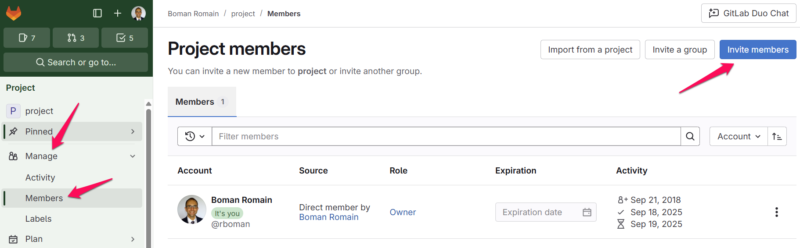


---
# <i class="fa-solid fa-user-plus"></i> Add a collaborator to your project

<div style="display: flex; gap: 20px;">
<div style="flex: 1;">

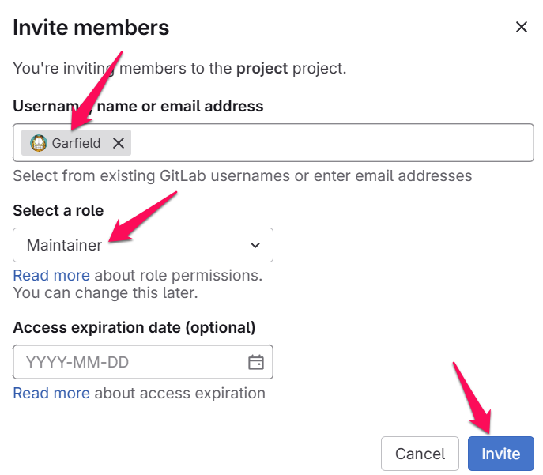

</div>
<div style="flex: 1;">

<br />
<br />

> The **"Maintainer" role** is used here in this tutorial to be able to push the main branch without creating a [merge request](#toc_merge_request) (see later).
> 
> Usually the **Developer role** is sufficient.

</div></div> 


---
# <i class="fa-solid fa-users"></i> Branches and git workflows

- Multiple versions can be simultaneously developed by adding dedicated **branches** to the tree structure of the repository.
- Git does not tell you how to name and to use the branches. The choice of your preferred **git workflow** is up to you.  


---
# <i class="fa-solid fa-users"></i> Collaborate with others


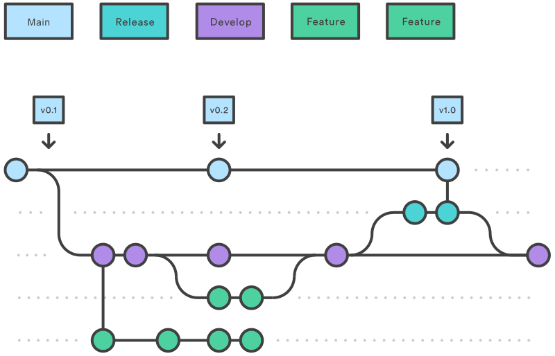

from [Gitflow Workflow | Atlassian Git Tutorial](https://www.atlassian.com/git/tutorials/comparing-workflows/gitflow-workflow) ... don't do this today!!


---
# <i class="fa-solid fa-code-branch"></i> Branches
<span id="toc_branches"></span>

In this presentation, we propose a **simpler approach** with a **basic set of rules**:

1. (At least) **one branch per developer** is created.
2. The `main` branch refers to the **latest "stable" version** of the work. 
     - In the case of software projects, it is a good practice to impose that the source code in `main` can be compiled without errors and passes a series of non-regression tests.
     - In the case of documents, the `main` version is the reference one (the last revised one, the one sent for publication, etc.)
3. No one works directly in the `main` branch.
4. Changes in `main` occur by merging another branch (GitLab calls this a **merge request**). It is a "request" because the branch is usually reviewed and merged by lead developers, and not by the author of the modifications!

---
# <i class="fa-solid fa-code-branch"></i> Branches

<i class="fa-regular fa-square-caret-right"></i> **Act as "*Developer 1*"** and create a branch named `dev1` with:
```
git branch dev1
```
<i class="fa-regular fa-square-caret-right"></i> Jump to this branch:
```
git checkout dev1
```
<i class="fa-regular fa-square-caret-right"></i> Check that you are on this branch:
```
git status
```
```
On branch dev1
nothing to commit, working tree clean
```

---
# <i class="fa-solid fa-code-branch"></i> Branches

- In practice, branches can be seen as **"flags" pointing to a particular commit** in the repository tree.
- "*Adding a branch*" is just adding a new flag (or a new "pointer") where we are.
 
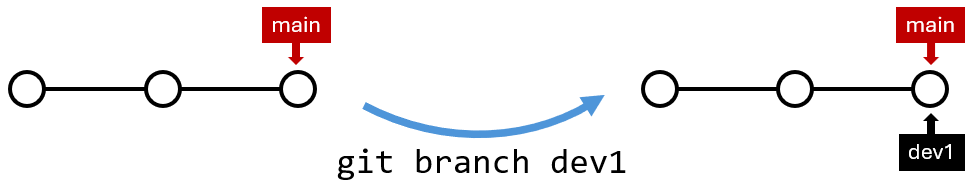

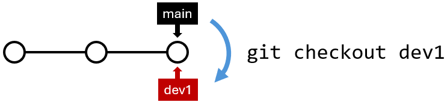

---
# <i class="fa-solid fa-code-branch"></i> Branches

- "*Being on branch* `dev1`" means that the flag moves with us following our next commits:

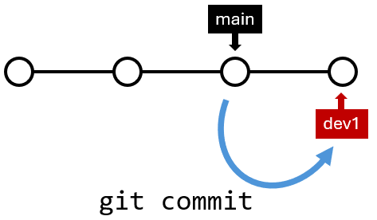

... and the `main` flag stays behind.

---
# <i class="fa-solid fa-code-branch"></i> Branches

<i class="fa-regular fa-square-caret-right"></i> Display the list of branches with:
```
git branch      # option "-a" also displays remote branches
```
```
* dev1
  main
```
where the current branch is indicated with an asterisk.

<i class="fa-regular fa-square-caret-right"></i> Combine `git branch` and `git checkout`:
```
git checkout -b dev1
```

<i class="fa-regular fa-square-caret-right"></i> Delete a branch:
```
git branch -d dev1
```


---
# <i class="fa-solid fa-code-branch"></i> Branches

<i class="fa-regular fa-square-caret-right"></i> Send the branch `dev1` to the remote repository
```
git push -u origin dev1
```
This should be done only once per new branch.

---
# <i class="fa-solid fa-code-pull-request"></i> Merge branches
<span id="toc_merge_branches"></span>

Do a modification:
```
git checkout dev1
[...edit file main.c]
git diff
```
```
diff --git a/main.c b/main.c
index 1e4bf9e..8173534 100644
--- a/main.c
+++ b/main.c
@@ -1,5 +1,5 @@
 #include <stdio.h>
 int main() {
-  printf("Hello world!\n");
+  printf("Hello my friend!\n");
   return 0;
``` 


---
# <i class="fa-solid fa-code-pull-request"></i> Merge branches

<i class="fa-regular fa-square-caret-right"></i> Make a new commit in `dev1` and push it to GitLab
```
git add main.c
git commit -m "modify message"
git push
```

<br />

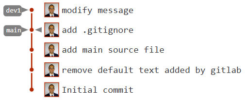

---
# <i class="fa-solid fa-code-pull-request"></i> Merge branches

In the meantime, the second developer (Developer 2) cloned the repository on his own computer. 

> <i class="fa-solid fa-screwdriver-wrench"></i> Ask a friend to play the role of Developer 2

He created a branch named `dev2` and changed the text too:

```
git clone git@gitlab.uliege.be:rboman/project.git
cd project
git checkout -b dev2
git push -u origin dev2
[edit main.c]
git diff
```

```
-  printf("Hello world!\n");
+  printf("Hello world! Have a nice day!\n");
```
```
git add . ; git commit -m "improve message" ; git push
```

---
# <i class="fa-solid fa-code-pull-request"></i> Merge branches

This is the state of the repository on GitLab:

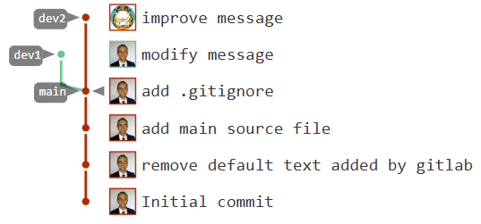

Remember that there are **3 copies of the repository**:
- the one on GitLab (see above)
- the one of the first developer (which does not contain the `dev2` branch)
- the one of the second developer (which does or does not contain the `dev1` branch depending on when he did the clone).


---
# <i class="fa-solid fa-code-pull-request"></i> Merge branches

Developer 1 wants to merge his branch `dev1` into `main`.

Although it is not necessary here, it is a good practice to sync the state of the GitLab repository with his local repository:

<i class="fa-regular fa-square-caret-right"></i> Fetch the state of the remote repository into your local copy:

```
git fetch
```
```
...
Unpacking objects: 100% (3/3), 318 bytes | 24.00 KiB/s, done.
From gitlab.uliege.be:rboman/project
 * [new branch]      dev2       -> origin/dev2

```

The `fetch` operation is never destructive. **It never alters the working tree**.
You can do it as frequently as you want in order to stay synchronized with GitLab.

---
# <i class="fa-solid fa-code-pull-request"></i> Merge branches

Visually:
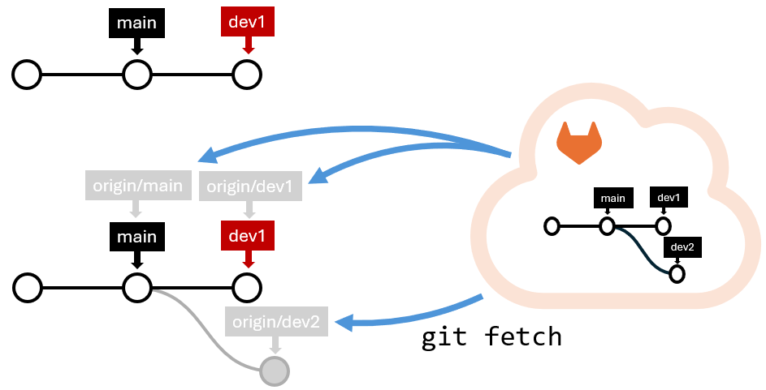

---
# <i class="fa-solid fa-code-pull-request"></i> Merge branches

<i class="fa-regular fa-square-caret-right"></i> Go to `main` as Developer 1:

```
git checkout main
```

<br />

Git says that his local `main` branch is up to date with `origin/main`, which was just synchronized with GitLab.

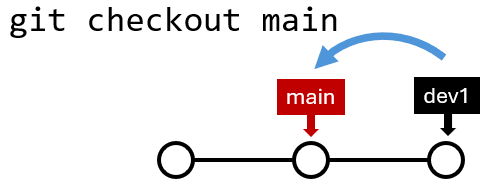

where red means "current active branch"; 
(we could also have added an arrow named `HEAD`)

---
# <i class="fa-solid fa-code-pull-request"></i> Merge branches

<i class="fa-regular fa-square-caret-right"></i> Merge branch `dev1` into `main` with the command:
```
git merge dev1
```
```
Updating b27ec90..ee3701b
Fast-forward
 main.c | 2 +-
 1 file changed, 1 insertion(+), 1 deletion(-)
```

This merge operation is a **fast-forward**: *there is a direct forward path* from `main` to `dev1`.

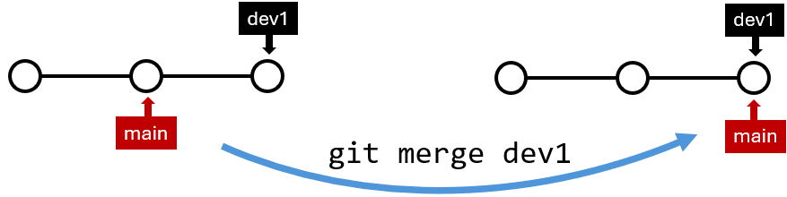

---

# <i class="fa-solid fa-code-pull-request"></i> Merge branches

<i class="fa-regular fa-square-caret-right"></i>  Developer 1 pushes the result of the merge. 

```
git push
```
This just moves the flag `main` on GitLab to the commit pointed by `dev1`. 
No additional commit is created.

<br />

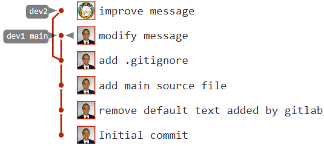

---
# <i class="fa-solid fa-code-pull-request"></i> Merge branches

Developer 2 wants to merge his changes to `main`.

<i class="fa-regular fa-square-caret-right"></i> He should first **fetch** the state of the GitLab repository to his local cache.

```
git fetch
```

<br/>

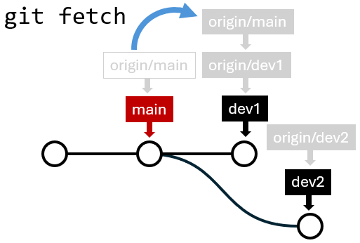


---
# <i class="fa-solid fa-code-pull-request"></i> Merge branches

<i class="fa-regular fa-square-caret-right"></i> Developer 2 goes onto the `main` branch:

```
git checkout main
```
```
Switched to branch 'main'
Your branch is behind 'origin/main' by 1 commit, and can be fast-forwarded.
  (use "git pull" to update your local branch)
```
As seen earlier, the branch `origin/main` (copied from GitLab by the previous fetch) and the local `main` do not point to the same commit.

<br/>

The `git pull` command suggested by git is equivalent to:

```
git fetch
git merge origin/master
```
This is a **fast-forward** (direct forward path from `main` to `origin/main`).

---
# <i class="fa-solid fa-code-pull-request"></i> Merge branches

The pull operation is equivalent to fetch and merge:

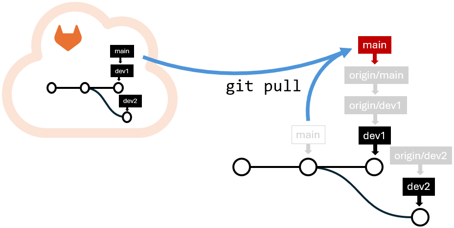


---
# <i class="fa-solid fa-code-pull-request"></i> Merge branches

<i class="fa-regular fa-square-caret-right"></i> Developer 2 can **merge** `dev2` into `main`. From the `main` branch, he types:

```
git merge dev2
```
```
Auto-merging main.c
CONFLICT (content): Merge conflict in main.c
Automatic merge failed; fix conflicts and then commit the result.
```
The **conflict** was expected. 

<i class="fa-regular fa-square-caret-right"></i> Running `git status`:

```
You have unmerged paths.
  (fix conflicts and run "git commit")
  (use "git merge --abort" to abort the merge)

Unmerged paths:
  (use "git add <file>..." to mark resolution)
        both modified:   main.c
```

---
# <i class="fa-solid fa-code-pull-request"></i> Merge branches

Git tried its best to merge the 2 versions but it was impossible. 

Conflicting lines are surrounded by `<<<<<<<`, `=======` and `>>>>>>>`.
```
#include <stdio.h>
 int main() {
 <<<<<<< HEAD
  printf("Hello my friend!\n");
 =======
  printf("Hello world! Have a nice day!\n");
 >>>>>>> dev2
  return 0;
 }
```

Fixing the conflict means:
- removing these sections, 
- saving the file, 
- adding it and finishing the commit (we are indeed in a commit process).

---
# <i class="fa-solid fa-code-pull-request"></i> Merge branches

<i class="fa-regular fa-square-caret-right"></i> Developer 2 edits the file:
```
#include <stdio.h>
int main() {
  printf("Hello my friend! Have a nice day!\n");
  return 0;
}
```

<br/>

<i class="fa-regular fa-square-caret-right"></i> Then he finishes the merge commit:

```
git add main.c
git commit        # git proposes "Merge branch 'dev2'" as commit message
git push
```

---
# <i class="fa-solid fa-code-pull-request"></i> Merge branches

Here is the resulting **Repository Graph** on GitLab:

<br/>

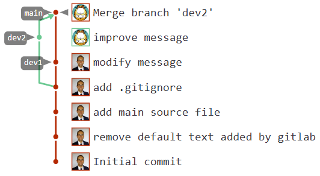

---

# <i class="fa-solid fa-code-pull-request"></i> Merge branches

> <i class="fa-solid fa-circle-question"></i> What are the commands that should be executed by Developer 1 to retrieve the modification of the `main` branch and continue his work on the `dev1` branch?

Solution:

Here is the current state of his local repository:

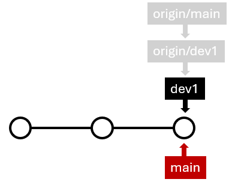

---

# <i class="fa-solid fa-code-pull-request"></i> Merge branches
He first need to sync his repository with GitLab with `git fetch`.
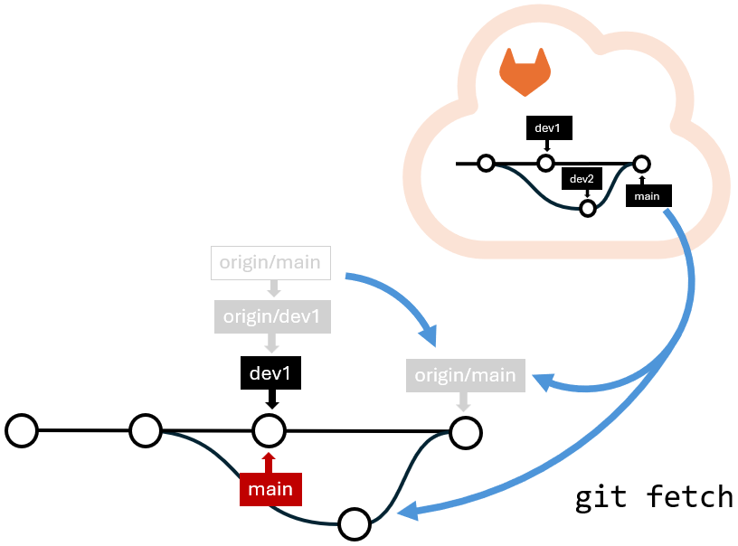

---

# <i class="fa-solid fa-code-pull-request"></i> Merge branches

Then he makes his branch active, since he wants to update it with the content of the `main` branch of GitLab.

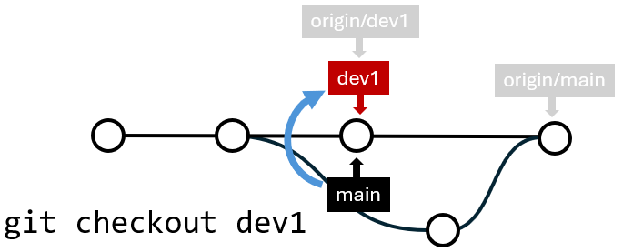

---

# <i class="fa-solid fa-code-pull-request"></i> Merge branches

The next step is to perform the merge operation. 

<br />

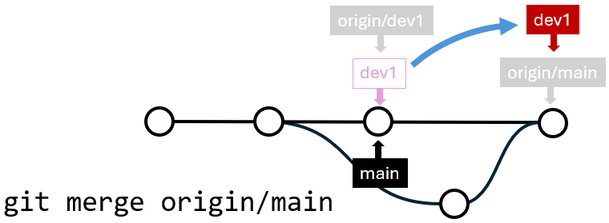

<br />
<br />

This is an easy "fast-forward merge".

---

# <i class="fa-solid fa-code-pull-request"></i> Merge branches

Eventually he must inform GitLab of the new position of the `dev1` branch.

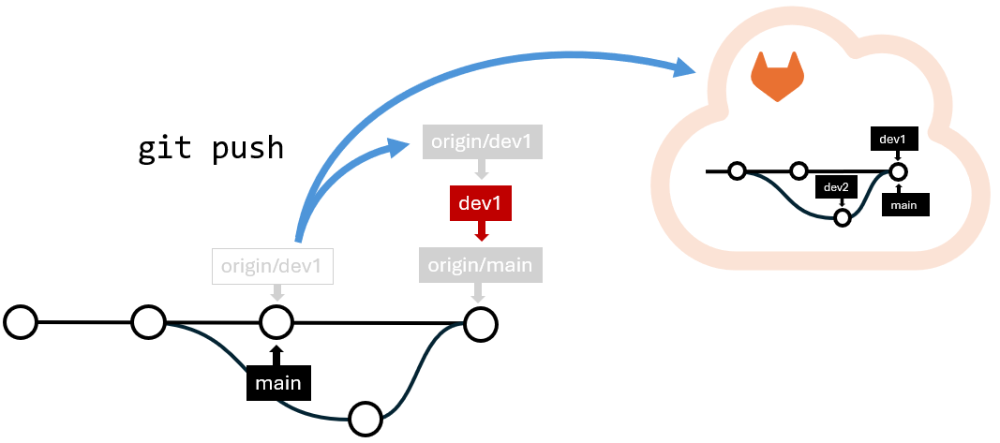

If you have understood all these steps, you are ready to work with branches.

---
# <i class="fa-solid fa-tag"></i> Tag a particular versions
<span id="toc_git_tag"></span>

Tags can be used to put a **fixed flag and a name** on a particular commit. In other words, this is a branch which never moves.

Tags are useful to make **releases** of your work such a `v1.0` or `deadline1`.

<i class="fa-regular fa-square-caret-right"></i>  Be sure to be on the correct commit you want to tag (e.g. latest `main`):
```
git checkout main
git pull
```
<i class="fa-regular fa-square-caret-right"></i> Create tag locally:

```
git tag v1.0
```
<i class="fa-regular fa-square-caret-right"></i> Push the local tags to GitLab:

```
git push --tags
```
---
# <i class="fa-solid fa-lightbulb"></i> Interesting commands
<span id="toc_interesting_cmds"></span>

| command | description |
| --- | --- |
| `git clean -xdf` | remove all the files not handled by git in your working tree. |
| `git checkout ee3701b` | set your working tree (`HEAD`) to commit `ee3701b` - this is useful to create a branch from any commit |
| `git reflog` | list all the local commits, even those not pointed by a branch (useful if you delete a branch by mistake) |
| `git diff thing1 thing2` | compare 2 revisions where "thing1" and "thing2" can be a tag, a branch name, a commit hash, etc. |
| `git diff thing1` | compare your working tree with "thing1" |

---
# <i class="fa-solid fa-lightbulb"></i> Interesting commands

| command | description |
| --- | --- |
| `git blame <file>` | display `file` prefixing each line with the author of its last modification |
| `git commit --help` | open the help for the commit command in a browser |

---
# <i class="fa-solid fa-lightbulb"></i> Interesting commands

<i class="fa-regular fa-square-caret-right"></i> Display a text representation of the repository in a terminal
```
git log --graph --oneline --all
```

```
*   9376c56 (HEAD -> main, tag: v1.0, origin/main, origin/dev1, origin/HEAD, dev1) Merge branch 'dev2'
|\
| * c12e237 (origin/dev2) improve message
* | ee3701b modify message
|/
* b27ec90 add .gitignore
* 01d0048 add main source file
* e4ebafc remove default text added by gitlab
* e59d025 Initial commit
```

---
# <i class="fa-solid fa-circle-xmark"></i> git commands not covered here

<br />

- **Creating a repository locally** ([git init](https://git-scm.com/docs/git-init)) allows you to create a local repository without GitLab.
- **Rebasing** ([git rebase](https://git-scm.com/docs/git-rebase)) is another way to merge branches. It replays commits of a branch on top of the current branch in order to keep a linear history (don't do that if you work with others). It is also used to move a branch.
- **Stashing** ([git stash](https://git-scm.com/docs/git-stash)) is a way to keep modifications in a memory in order to apply them later or somewhere else in the repository.
- **Resetting** ([git reset](https://git-scm.com/docs/git-reset)) allows you to reset the index and/or the working tree from a particular state in order to go back in time or replay commits.
- ...

---

<!-- footer: ' <i class="fa-brands fa-square-git"></i> a Hands-on Tutorial &mdash; [<i class="fa-solid fa-envelope"></i>](mailto:r.boman@uliege.be) R.Boman &mdash; <i class="fa-solid fa-calendar"></i> sep 2025 &mdash; 
[<i class="fa-solid fa-house"></i>](#table-of-contents)'
-->
<!-- _backgroundImage: url('https://marp.app/assets/hero-background.svg') -->
<!-- _class: lead -->


# 4. Additional tools

<br />

- <i class="fa-solid fa-laptop"></i> [... on your computer](#toc_tools_on_your_computer)
- <i class="fa-brands fa-square-gitlab"></i> [... on GitLab](#toc_tools_on_gitlab)

---

<!-- footer: ' <i class="fa-brands fa-square-git"></i> a Hands-on Tutorial &mdash; [<i class="fa-solid fa-envelope"></i>](mailto:r.boman@uliege.be) R.Boman &mdash; <i class="fa-solid fa-calendar"></i> sep 2025 &mdash; 
[<i class="fa-solid fa-house"></i>](#table-of-contents)
- [additional tools](#4-additional-tools)' 
-->

# <i class="fa-solid fa-laptop"></i> Additional Tools (on your computer)
<span id="toc_tools_on_your_computer"></span>

## gitk

<div style="display: flex; gap: 20px;">
<div style="flex: 1;">

`gitk` is a basic GUI which is **already installed** with git on Windows.

```
gitk --all
```

It is very convenient for displaying the state of local repositories.

Installation <i class="fab fa-ubuntu"></i>
```
sudo add-apt-repository universe  # in WSL
sudo apt install gitk
```
<br/>

<i class="fas fa-globe"></i> [gitk documentation](https://git-scm.com/docs/gitk)

</div>
<div style="flex: 1;">

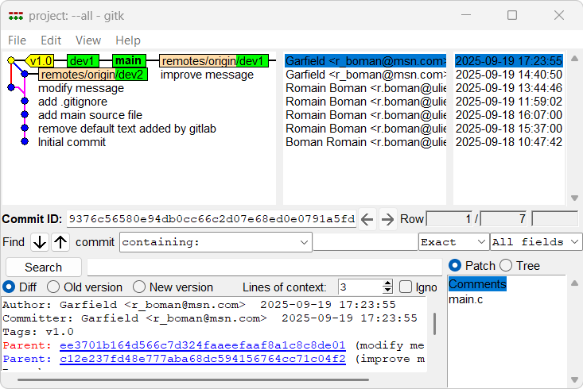

</div></div>


---
# <i class="fa-solid fa-laptop"></i> Additional Tools (on your computer)

## VS Code

<div style="display: flex; gap: 20px;">
<div style="flex: 1;">

[Visual Studio Code](https://code.visualstudio.com/) is a convenient **multi-platform** IDE.

It allows you...
- to perform all the git commands with your mouse,
- to manage the staging area before a commit,
- to see differences between files and help you resolve conflicts while merging,
- and much more ([see doc](https://code.visualstudio.com/docs/sourcecontrol/overview)).


</div>
<div style="flex: 1;">

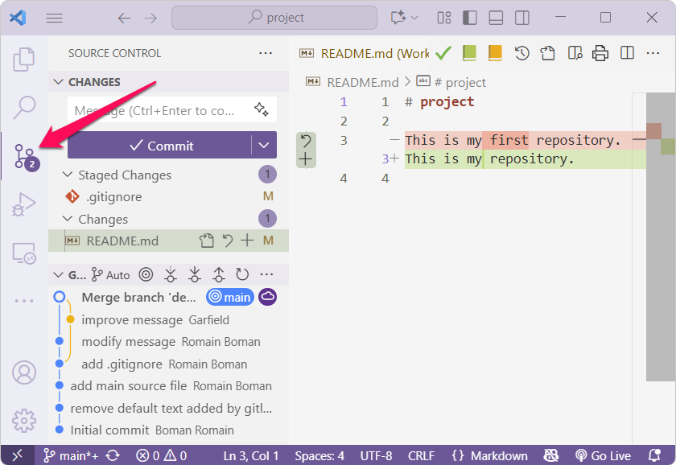

</div></div>


---


# <i class="fa-brands fa-square-gitlab"></i> Additional Tools (on GitLab)
<span id="toc_tools_on_gitlab"></span>

## Issues

<div style="display: flex; gap: 20px;">
<div style="flex: 1;">

- "Issues" are used by GitLab to keep track of bugs found by users or feature requests, etc.

- You can also create "Issues" to plan your future work. 

</div>
<div style="flex: 1;">

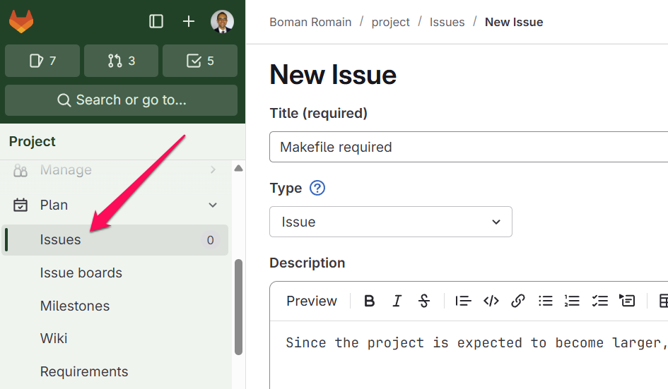

</div></div>


---


# <i class="fa-brands fa-square-gitlab"></i> Additional Tools (on GitLab)
<span id="toc_tools_on_gitlab"></span>

## Issues

<div style="display: flex; gap: 20px;">
<div style="flex: 1;">

- You can refer to a particular issue anywhere on GitLab with `#` then its number.

- Each issue has a description and a discussion area where developers can discuss it. Tag someone with the `@` symbol.

> 💡 Use issues to communicate with the other developers!

</div>
<div style="flex: 1;">

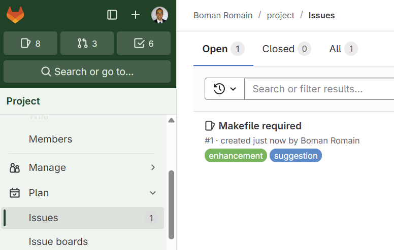

</div></div>

---
# <i class="fa-brands fa-square-gitlab"></i> Additional Tools (on GitLab)

## Merge requests (MR)
<span id="toc_merge_request"></span>

Instead of merging your branch to `main`, then pushing it to GitLab as earlier, GitLab works with **merge requests** (this is called a **pull request** on GitHub).

Follow these steps:
- Merge `main` into your branch,
- Request the merging of your branch into `main` with the MR system (similar to issues): write a detailled description and be ready to discuss with your co-workers in a discussion area.
- The other developers will receive an e-mail telling them that you want to update `main`.
- Wait for their comments and their agreement before merging the MR.


---
# <i class="fa-brands fa-square-gitlab"></i> Additional Tools (on GitLab)

## Merge requests (MR)

Sequence of commands:
```
git checkout main                 # switch to the local main branch
git pull                          # sync local main with GitLab's main
git checkout -b add_makefile      # create a new branch locally
...                               # do the work
git add Makefile .gitignore       # add modifications to staging area
git commit -m "add Makefile"      # commit changes
git push -u origin add_makefile   # push to GitLab
```
If other MRs were merged to `main` in the meantime, update your branch:
```
git fetch                         # retreive the state of GitLab
git merge origin/master           # merge origin/main
git push                          # push the changes
```

---
# <i class="fa-brands fa-square-gitlab"></i> Additional Tools (on GitLab)

## Merge requests (MR)

<div style="display: flex; gap: 20px;">
<div style="flex: 1;">

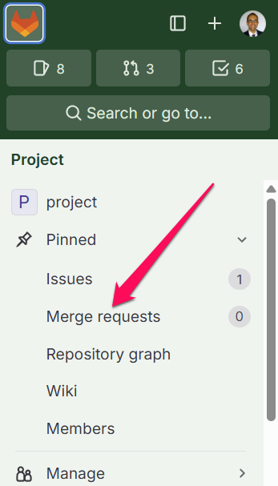


</div>
<div style="flex: 1;">

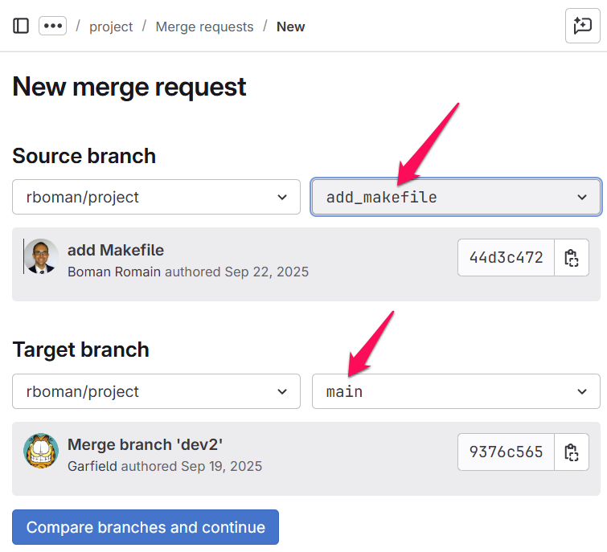

</div></div>


---
# <i class="fa-brands fa-square-gitlab"></i> Additional Tools (on GitLab)

<div style="display: flex; gap: 20px;">
<div style="flex: 1;">

## Merge requests (MR)

- Choose a meaningful title,
- Write an extensive description of the modifications,
- Review the modifications with the **Changes** tab,
- Check the options (draft status, source branch deletion, reviewer names, etc),
- Click on **create merge request**,
- Edit the MR if you did a mistake.

</div>
<div style="flex: 1;">

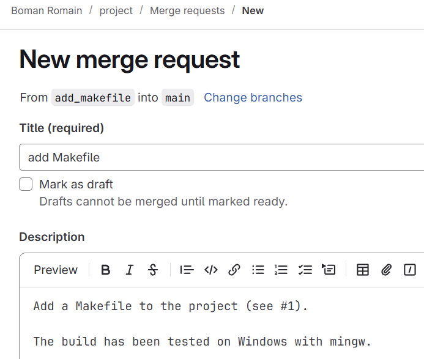
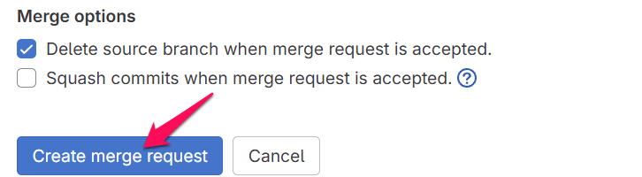

</div></div>


---
# <i class="fa-brands fa-square-gitlab"></i> Additional Tools (on GitLab)

<div style="display: flex; gap: 20px;">
<div style="flex: 1;">

## Merge requests (MR)

- Push commits to your branch if modifications are requested (the MR is automatically updated).
- When everything is OK, merge or let a "Maintainer" merge your work.


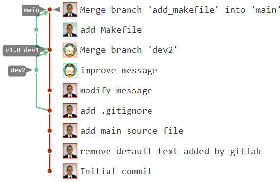

</div>
<div style="flex: 1;">

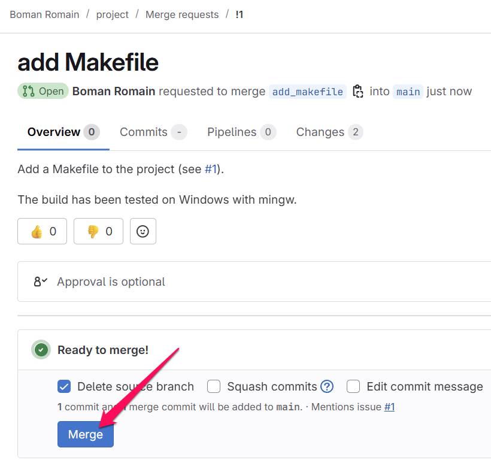

</div></div>


---
# <i class="fa-brands fa-square-gitlab"></i> Additional Tools (on GitLab)


<div style="display: flex; gap: 20px;">
<div style="flex: 1;">

## Wiki

- Each project can have its own "wiki" (system similar to the wikipedia). 

- This is an easy way to write a basic website describing the project, adding some documentation, etc.
- The content is stored in a second repository linked to the project. 
- It uses text files written with the [markdown syntax](https://www.markdownguide.org/getting-started/).

</div>
<div style="flex: 1;">

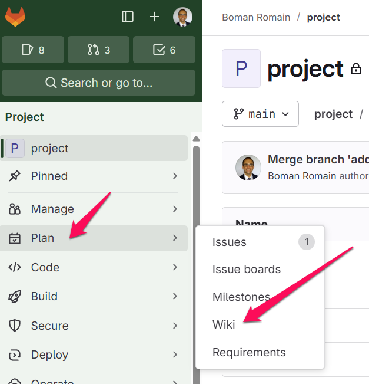

</div></div>


---
# <i class="fa-brands fa-square-gitlab"></i> Additional Tools (on GitLab)

## Continuous integration

Another useful application offered by GitLab is the "continuous integration". It allows you to run specific tasks by GitLab each time a `git push` is made. 
It can be used:
- to build and test your code,
- to deploy an installer or some documentation to a website,
- etc.

The tasks to be executed are written in a file named `.gitlab-ci.yml`:

```
image: gcc:latest
build_and_run:
  script:
    - make
    - ./helloworld
```

---
# <i class="fa-brands fa-square-gitlab"></i> Additional Tools (on GitLab)

## Continuous integration

<div style="display: flex; gap: 20px;">
<div style="flex: 1;">

- Each time you push your code, the tasks are executed. 

- You receive a mail when something goes wrong...

- Merging MR can be prohibited for branches that do not pass the tests.

</div>
<div style="flex: 1;">

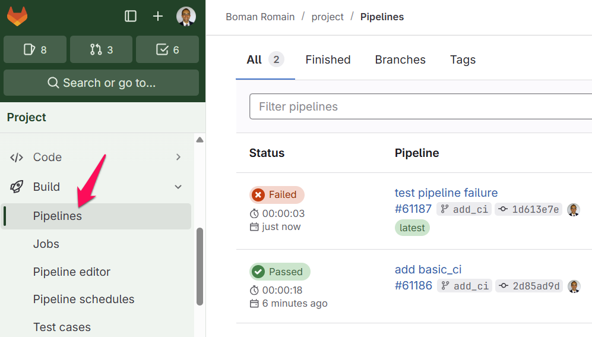

</div></div>


---
# <i class="fa-brands fa-square-gitlab"></i> Additional Tools (on GitLab)

## GitLab Pages

- Continuous integration can be used to **publish web pages on the internet**.
- Each project has its own "**gitlab pages**" URL.
- This very presentation is managed by git and published to the web thanks to the continuous integration of GitLab using this system.
- The slides are automatically converted from markdown files to html and pdf thanks to [Marp](https://marp.app/) each time a change is pushed to GitLab.
- see: https://gitlab.uliege.be/git/hands-on-tutorial

---

<!-- footer: ' <i class="fa-brands fa-square-git"></i> a Hands-on Tutorial &mdash; [<i class="fa-solid fa-envelope"></i>](mailto:r.boman@uliege.be) R.Boman &mdash; <i class="fa-solid fa-calendar"></i> sep 2025 &mdash; 
[<i class="fa-solid fa-house"></i>](#table-of-contents)' 
-->
<!-- _backgroundImage: url('https://marp.app/assets/hero-background.svg') -->
<!-- _class: lead -->


# 5. Conclusions

<br />

- <i class="fa-regular fa-lightbulb"></i> [Final hints](#toc_final_hints)
- <i class="fa-solid fa-bookmark"></i> [References](#toc_references)

---

<!-- footer: ' <i class="fa-brands fa-square-git"></i> a Hands-on Tutorial &mdash; [<i class="fa-solid fa-envelope"></i>](mailto:r.boman@uliege.be) R.Boman &mdash; <i class="fa-solid fa-calendar"></i> sep 2025 &mdash; 
[<i class="fa-solid fa-house"></i>](#table-of-contents)
- [conclusions](#5-conclusions)' 
-->

# <i class="fa-regular fa-lightbulb"></i> Final hints
<span id="toc_final_hints"></span>

- Try to learn Git commands **in the terminal** before relying on VS Code.
- **Do not push unnecessary files** (`.DS_Store` on mac, `settings.json` of VS Code)! Add a `.gitignore` to your project. 
- Always **check the files** that are in the staging area before each commit. Review the modifications with VS Code.
- It is useful to **format your code** with a formatter such as [clang-format](https://clang.llvm.org/docs/ClangFormat.html) to minimize the differences between 2 revisions (Alt-shift-F on VS Code + Windows).
- **Communication** with your teammates is very important: tell what you are currently doing to the other developers (using comments, issues, merge requests on GitLab... or by any other means such as Messenger, Discord, Teams, e-mails or, even better, face-to-face). 
  

---

# <i class="fa-solid fa-bookmark"></i> References and links
<span id="toc_references"></span>

<br/>

- [Pro Git (S.Chacon & B.Straub)](https://git-scm.com/book/en/v2): the (free) reference book.
- [GitLab University](https://university.gitlab.com/): tutorials from gitlab.com.
- [Getting Git Right](https://www.atlassian.com/git): very well written tutorials from Atlassian.
- [Oh Shit, Git!?!](https://ohshitgit.com/): undo mistakes.
- [How Git Works! (J.Evans)](https://jvns.ca/blog/2024/04/25/new-zine--how-git-works-/): not free but very nice.

<br/>
<br/>
Legal copies of non-free books about git:

> 💡 https://lib.uliege.be/ then look for "git"!

